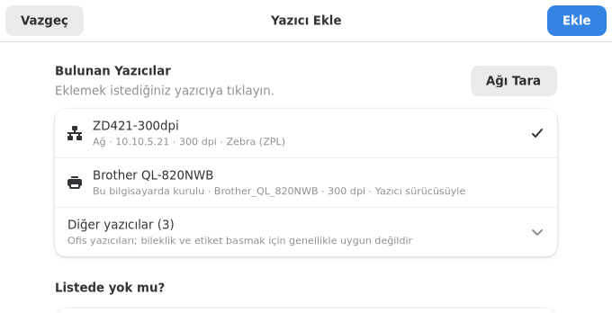
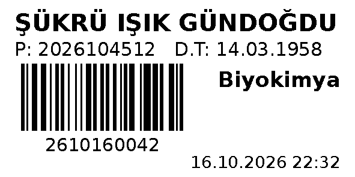
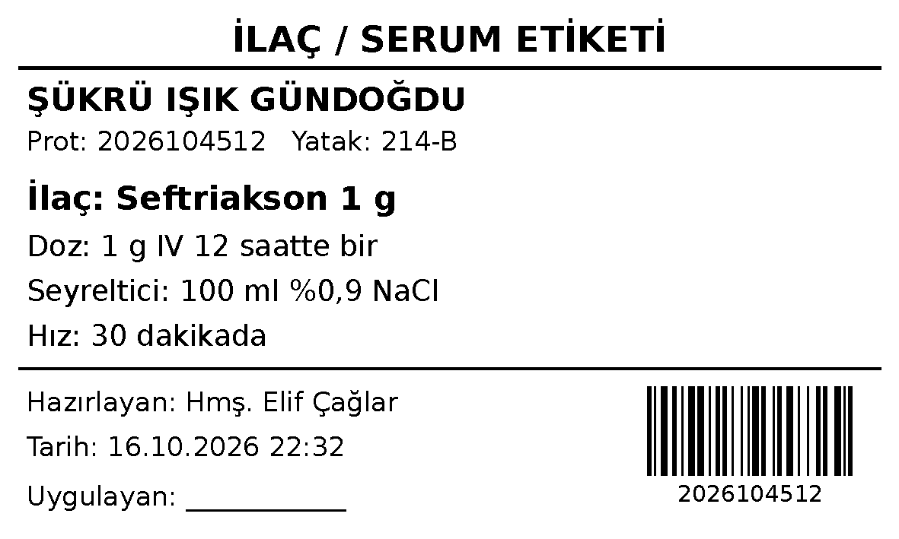

# Künye

Türkçe · **[English](README.en.md)**

Pardus için açık kaynak **hasta bilekliği, barkod ve etiket basıcı**.

Hastanelerde bileklik, laboratuvar tüpü, ilaç/serum ve dosya etiketi basmak
için Windows'ta genellikle BarTender ya da NiceLabel gibi lisanslı yazılımlar
kullanılır. Künye aynı işi Pardus'ta ücretsiz yapar: şablonu seçer, hasta
bilgilerini yazar, önizlemeye bakar ve basarsınız.


> **Durum: erken geliştirme (0.1).** Etiket üretimi, barkodlar ve arayüz
> otomatik testlerle doğrulandı; ancak **gerçek bir etiket yazıcısında henüz
> denenmedi.** Hastanede kullanmadan önce kendi yazıcınızda deneme baskısı
> alın ve barkodları okutarak kontrol edin. Sonuçları
> [Issues](https://github.com/muratGursel/kunye/issues) sayfasında paylaşırsanız
> çok yardımcı olur.

## Özellikler

- **Hazır şablonlar:** yetişkin bilekliği, bebek bilekliği, laboratuvar tüpü,
  ilaç/serum etiketi, hasta dosyası etiketi. Kendi şablonlarınızı JSON ile
  ekleyebilirsiniz.
- **Türkçe karakterler her yazıcıda doğru basılır.** Etiket önce görüntü
  olarak çizilir, yazıcıya bu görüntü gönderilir; yazıcının yerleşik
  fontlarına bağlı kalınmaz. Önizlemede gördüğünüz, basılanla birebir aynıdır.
- **Doğru büyük harf:** `şükrü ışık` → `ŞÜKRÜ IŞIK`, `penisilin` → `PENİSİLİN`.
- **Barkod ve QR kod:** Code 128 (rakamlar için kısa C kipi) ve QR.
- **Yazıcılar:** Zebra (ZPL) yazıcılara ağdan ya da CUPS üzerinden;
  ZPL bilmeyen termal yazıcılara (TSC vb.) CUPS sürücüsüyle.
- **Toplu basım:** HBYS ya da Excel'den alınan CSV dosyasından. `;` ayraçlı ve
  Windows-1254 kodlamalı dosyalar kendiliğinden tanınır.
- **Hasta güvenliği:** basımdan sonra form temizlenir; önizleme hata verirse
  eski önizleme silinir, ekranda başka hastanın etiketi kalmaz; zorunlu alan
  eksikse basılmaz.
- **Kolay yazıcı ekleme:** kurulu yazıcılar ve ağdaki Zebra yazıcılar
  listelenir; model ve çözünürlük yazıcıdan okunur. Dosya düzenlemeye gerek
  yoktur. Eklenen yazıcıdan tek tıkla deneme baskısı alınır.
- **Merkezi yönetim:** yazıcı ve şablon tanımları `/etc/kunye` altına konarak
  (ör. Lider Ahenk ile) bütün bilgisayarlara dağıtılabilir.

## KVKK

- TC kimlik numarası `{tc_kimlik|maskele}` ile yalnızca son 4 hanesi görünecek
  şekilde basılır (`*******8901`).
- Künye hiçbir veriyi ağa ya da buluta göndermez, kayıt tutmaz. Bilgiler
  yalnızca seçilen yazıcıya gider.

## Kurulum (Pardus 23 / 25, Debian tabanlı sistemler)

Uçbirimde tek komut:

```sh
curl -fsSL https://raw.githubusercontent.com/muratGursel/kunye/main/install.sh | sudo sh
```

Ya da [Sürümler](https://github.com/muratGursel/kunye/releases) sayfasından
`kunye_*_all.deb` dosyasını indirip kurun:

```sh
sudo apt install ./kunye_*_all.deb
```

Kurulumdan sonra uygulama menüsünde **Künye** olarak görünür. İlk açılışta
**Yazıcı Ekle**'ye basın: Künye bu bilgisayarda kurulu yazıcıları ve ağdaki
Zebra yazıcıları bulup listeler, birini seçmeniz yeterlidir. Ayrıntılar:
[docs/YAZICILAR.md](docs/YAZICILAR.md).



## Kullanım

**Masaüstü:** menüden Künye'yi açın → soldan şablonu seçin → bilgileri yazın →
**Bas** (Ctrl+P). Ayrıntılar: [docs/KULLANIM.md](docs/KULLANIM.md).

**Komut satırı:**

```sh
kunye sablonlar                                  # şablonları listele
kunye alanlar bileklik-yetiskin                  # şablonun alanları
kunye onizle bileklik-yetiskin --ornek           # onizleme.png üret
kunye bas bileklik-yetiskin -y acil-zebra \
    -a ad_soyad="Ayşe Çelik" -a protokol_no=2026104600 -a dogum_tarihi=01.02.1970
kunye bas tup-etiketi -y lab-zebra --csv numuneler.csv   # toplu basım
```

## Hazır şablonlar

| Kimlik | Ölçü | İçerik |
|---|---|---|
| `bileklik-yetiskin` | 25 × 279 mm | Ad soyad, doğum tarihi, cinsiyet, kan grubu, maskeli TC, servis, alerji kutusu, barkod, QR |
| `bileklik-bebek` | 25 × 152 mm | Anne adı, doğum tarihi ve saati, cinsiyet, kilo, barkod |
| `tup-etiketi` | 50 × 25 mm | Hasta adı, numune barkodu, tüp/test türü, tarih-saat |
| `ilac-etiketi` | 100 × 60 mm | Hasta, ilaç, doz, seyreltici, hız, hazırlayan, barkod |
| `dosya-etiketi` | 100 × 30 mm | Ad soyad, protokol, doğum tarihi, servis, barkod |

<p>


</p>

İlaç etiketi yalnızca girilen bilgiyi basar; doz hesabı ya da ilaç
etkileşimi denetimi yapmaz.

## Belgeler

| Belge | Kimin için |
|---|---|
| [Kullanım kılavuzu](docs/KULLANIM.md) | Hemşire, sekreter, laboratuvar personeli |
| [Yazıcı kurulumu](docs/YAZICILAR.md) | Bilgi işlem |
| [Şablon rehberi](docs/SABLONLAR.md) | Kendi etiketini tasarlayacaklar |
| [Geliştirici notları](docs/GELISTIRME.md) | Katkı vermek isteyenler |
| [Değişiklikler](CHANGELOG.md) | Herkes |

## Lisans

GPL-3.0-or-later. Ayrıntılar: [LICENSE](LICENSE).

BarTender, NiceLabel ve Zebra kendi sahiplerinin ticari markalarıdır. Bu proje
onlarla bağlantılı değildir.
