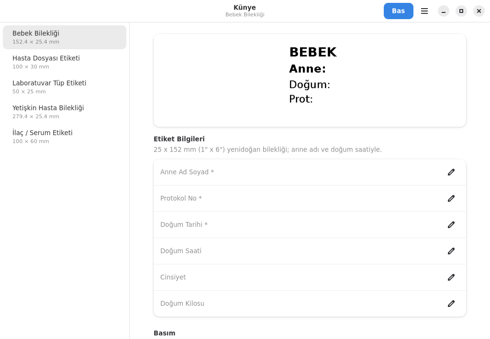
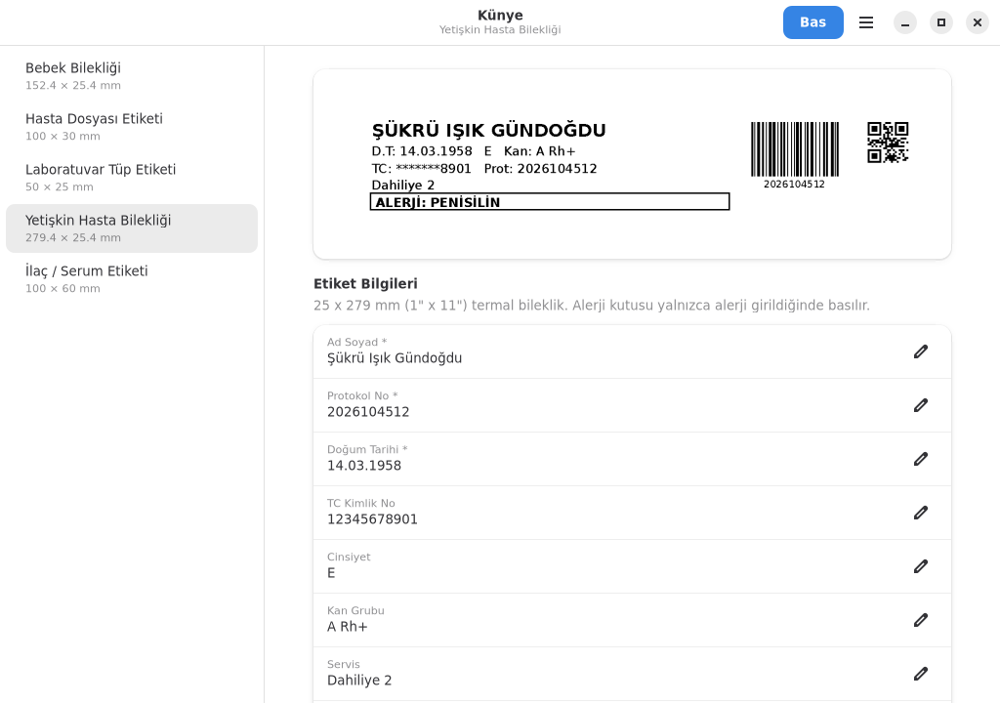
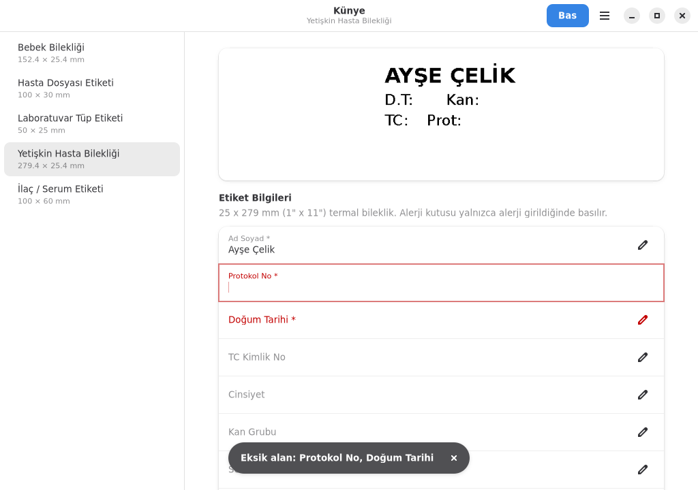
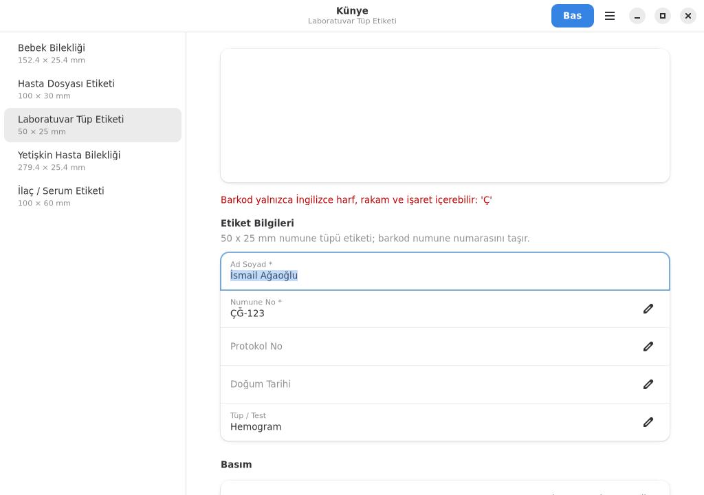
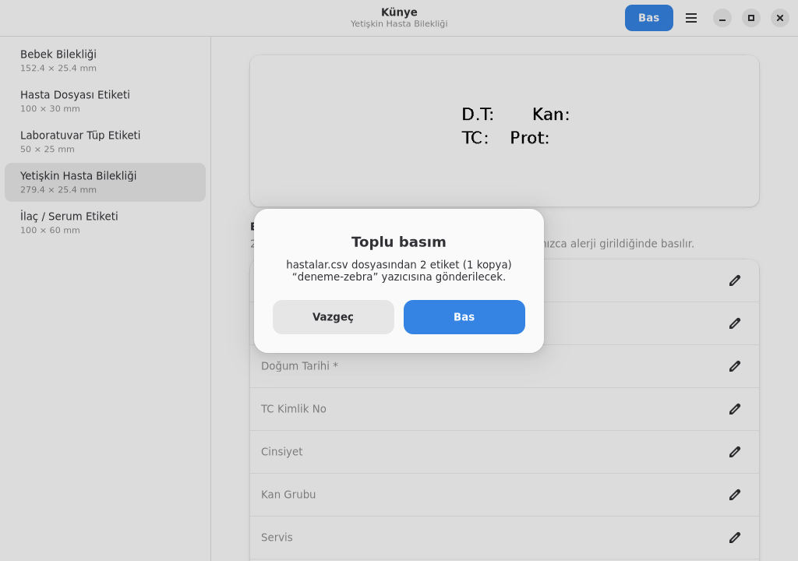

# Künye Kullanım Kılavuzu

Bu kılavuz Künye ile bileklik ve etiket basacak personel içindir: hemşire,
hasta kabul, laboratuvar ve servis sekreterleri.

> Ekran görüntülerindeki hasta bilgileri örnektir, gerçek kişilere ait değildir.

## İçindekiler

1. [Künye'yi açmak](#1-künyeyi-açmak)
2. [Pencerenin bölümleri](#2-pencerenin-bölümleri)
3. [Tek etiket basmak](#3-tek-etiket-basmak)
4. [Barkod okuyucuyla bilgi girmek](#4-barkod-okuyucuyla-bilgi-girmek)
5. [Eksik ya da hatalı bilgi](#5-eksik-ya-da-hatalı-bilgi)
6. [CSV dosyasından toplu basım](#6-csv-dosyasından-toplu-basım)
7. [Önizlemeyi dosyaya kaydetmek](#7-önizlemeyi-dosyaya-kaydetmek)
8. [Klavye kısayolları](#8-klavye-kısayolları)
9. [Sık sorulan sorular](#9-sık-sorulan-sorular)

## 1. Künye'yi açmak

Uygulama menüsünde **Künye**'ye tıklayın (Ofis bölümündedir). Uçbirimden açmak için: `kunye-arayuz`.

## 2. Pencerenin bölümleri



| Bölüm | Ne işe yarar |
|---|---|
| **Sol liste** | Etiket şablonları. Basmak istediğiniz etiketin türünü buradan seçin. |
| **Önizleme** | Etiketin basılacak hali. Siz yazdıkça güncellenir. |
| **Etiket Bilgileri** | Hasta bilgilerinin yazıldığı alanlar. `*` işaretli alanlar zorunludur. |
| **Basım** | Yazıcı seçimi ve her etiketten kaç kopya basılacağı. |
| **Bas** (sağ üst) | Etiketi seçili yazıcıya gönderir. |
| **☰ menü** (sağ üst) | Formu temizle, Künye hakkında, çıkış. |

Uzun bileklik etiketlerinde önizleme yalnızca yazılı kısmı gösterir; bilekliğin
boş kayış kısmı gösterilmez.

## 3. Tek etiket basmak

1. Sol listeden şablonu seçin, örneğin **Yetişkin Hasta Bilekliği**.
2. Bilgileri yazın. Önizleme siz yazdıkça değişir.
3. **Yazıcı** satırından doğru yazıcının seçili olduğunu kontrol edin.
4. **Bas** düğmesine tıklayın ya da **Ctrl+P**'ye basın.



Basım başarılı olunca pencerenin altında
"1 etiket … yazıcısına gönderildi" bildirimi çıkar ve **form kendiliğinden
temizlenir**. Böylece bir sonraki hastaya bir öncekinin bilgileriyle bileklik
basılması önlenir. Aynı etiketten birden çok gerekiyorsa basmadan önce
**Kopya sayısı**'nı artırın.

Bilmeniz gerekenler:

- **Ad soyad** ve **alerji** etikete büyük harfle basılır; siz küçük harfle
  yazabilirsiniz. Türkçe harfler doğru büyütülür (i → İ, ı → I).
- **TC kimlik numarası** bileklikte yalnızca son 4 hanesi görünecek şekilde
  basılır (`*******8901`).
- **Alerji** alanı boş bırakılırsa bileklikteki alerji kutusu hiç basılmaz.
- Ad çok uzunsa yazı önce küçültülür, yine sığmazsa sonu `…` ile kısaltılır.
  Önizlemede nasıl görüneceğini kontrol edin.
- Tarih ve saat (tüp ve ilaç etiketinde) bilgisayarın saatinden otomatik
  alınır.

## 4. Barkod okuyucuyla bilgi girmek

Barkod okuyucular okuttuktan sonra Enter tuşu gönderir. Künye'de bir alanda
Enter'a basıldığında imleç **sıradaki alana geçer**; etiket basılmaz. Bu
sayede protokol numarasını bir belgeden okutup diğer alanlara devam
edebilirsiniz. Basmak için her zaman **Bas** düğmesini ya da Ctrl+P'yi
kullanın.

## 5. Eksik ya da hatalı bilgi

**Zorunlu alan boşsa** Künye basmaz. Boş alanlar kırmızıyla işaretlenir,
imleç ilk boş alana gider ve altta hangi alanların eksik olduğu yazılır.



**Önizlemenin altında kırmızı bir yazı** çıkıyorsa etiket o haliyle
basılamaz; önizleme de bu yüzden boşaltılır. En sık görülen durumlar:

| Uyarı | Ne yapmalı |
|---|---|
| *Barkod yalnızca İngilizce harf, rakam ve işaret içerebilir* | Barkoda giden alanda (protokol no, numune no) Ç, Ğ, İ, Ö, Ş, Ü gibi bir harf var. Numarayı kontrol edin. |
| *Barkod (…) etiketin dışına taşıyor* | Girilen numara bu etikete sığmayacak kadar uzun. Numarayı kontrol edin; doğruysa bilgi işleme bildirin. |
| *Yazıcıya gönderilemedi* | Yazıcı kapalı, kâğıdı bitmiş ya da ağ bağlantısı yok olabilir. Yazıcıyı kontrol edip tekrar deneyin; sürerse bilgi işleme pencerede yazan hatayı iletin. |



## 6. CSV dosyasından toplu basım

Birden çok hastanın etiketini tek seferde basmak için (örneğin sabah
alınacak kan örnekleri):

1. Listeyi HBYS'den ya da Excel'den **CSV** olarak kaydedin. İlk satır
   sütun başlıkları olmalı.
2. Künye'de şablonu ve yazıcıyı seçin.
3. **CSV'den Toplu Bas…** düğmesine tıklayıp dosyayı seçin.
4. Kaç etiket basılacağını gösteren onay penceresinde **Bas**'a tıklayın.



Sütun başlıkları alan adlarına göre eşleştirilir; büyük-küçük harf, Türkçe
harf ve boşluk fark etmez. Örneğin `Ad Soyad`, `AD SOYAD` ve `ad_soyad`
aynı sütun sayılır. Laboratuvar tüpü için örnek bir dosya:

```text
Ad Soyad;Numune No;Protokol No;Tüp Türü
Ayşe Çelik;2610160042;2026104600;Biyokimya
İsmail Ağaoğlu;2610160043;2026104601;Hemogram
```

Hangi şablonun hangi sütunları beklediğini bilgi işlem `kunye alanlar
ŞABLON` komutuyla görebilir.

Dosyadaki herhangi bir satırda zorunlu bilgi eksikse **hiçbir etiket
basılmaz** ve eksik satırlar listelenir. Böylece toplu basım yarıda kalmaz.
Toplu basımdan sonra form temizlenmez.

## 7. Önizlemeyi dosyaya kaydetmek

**PNG Kaydet…** etiketin görüntüsünü 300 dpi PNG olarak kaydeder. Şablon
tasarlarken ya da bilgi işleme bir sorunu göstermek için kullanılabilir.

> Kaydedilen görüntüde hasta bilgileri vardır. KVKK gereği bu dosyaları
> paylaşmadan önce örnek verilerle oluşturun ya da işiniz bitince silin.

## 8. Klavye kısayolları

| Kısayol | İşlev |
|---|---|
| **Ctrl+P** | Etiketi bas |
| **Ctrl+L** | Formu temizle |
| **Enter** | Sıradaki alana geç |
| **Ctrl+Q** | Künye'den çık |

## 9. Sık sorulan sorular

**Bas düğmesi soluk, tıklanmıyor.**
Bu bilgisayar için yazıcı tanımlanmamış. Yazıcı satırında da "Yazıcı tanımlı
değil" yazar. Bilgi işleme başvurun ([YAZICILAR.md](YAZICILAR.md)).

**Etikette Türkçe harfler bozuk çıkıyor.**
Künye harfleri görüntü olarak gönderdiği için bu olmamalı. Olursa yazıcı
modelini ve etiketin fotoğrafını bilgi işleme iletin.

**Barkod okunmuyor.**
Önce yazıcının ısı (koyuluk) ayarını kontrol edin; soluk baskı en sık
nedendir. Etiket eğri ya da kesik basılıyorsa yazıcının etiket kalibrasyonu
yapılmalıdır.

**Yanlış hastaya bileklik bastım.**
Basılan bilekliği imha edin ve doğru bilgilerle yeniden basın. Künye basılan
etiketlerin kaydını tutmaz.
