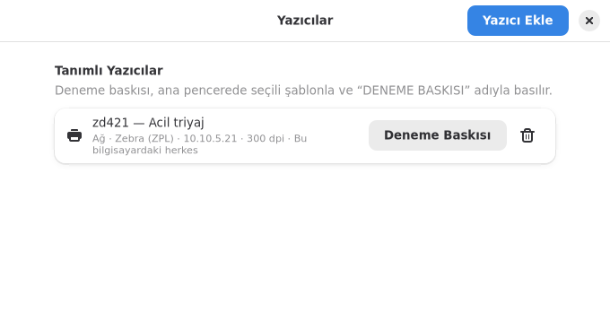

# Yazıcı Kurulumu (Bilgi İşlem)

Künye kurulduktan sonra **hangi yazıcılara basılacağı tanımlanana kadar
basım yapılamaz**. Arayüzde "Yazıcı tanımlı değil" yazar ve Bas düğmesi
soluk görünür. Yazıcı eklemek için dosya düzenlemeye gerek yoktur: Künye
yazıcıları bulup listeler, listeden seçmeniz yeterlidir.

## İçindekiler

1. [Arayüzden yazıcı eklemek](#1-arayüzden-yazıcı-eklemek)
2. [Komut satırından yazıcı eklemek](#2-komut-satırından-yazıcı-eklemek)
3. [Tanım dosyası nerede?](#3-tanım-dosyası-nerede)
4. [Dosya biçimi](#4-dosya-biçimi)
5. [Yazıcı türleri](#5-yazıcı-türleri)
6. [Çözünürlük (dpi)](#6-çözünürlük-dpi)
7. [Etiket yönü ve kalibrasyon](#7-etiket-yönü-ve-kalibrasyon)
8. [Bütün bilgisayarlara dağıtmak](#8-bütün-bilgisayarlara-dağıtmak)
9. [Sorun giderme](#9-sorun-giderme)

## 1. Arayüzden yazıcı eklemek

1. Künye'yi açın. Yazıcı tanımlı değilse **Basım** bölümündeki **Yazıcı Ekle**
   düğmesine basın. (Sonradan yazıcı eklemek ya da silmek için: ☰ menü →
   **Yazıcılar…**)
2. Açılan pencerede Künye yazıcıları kendiliğinden arar:
   - **Bu bilgisayarda kurulu yazıcılar:** Pardus'un yazıcı ayarlarında
     ekli olan her yazıcı.
   - **Ağdaki Zebra yazıcılar:** ağda kendini duyuranlar hemen listelenir.
     Görünmeyenler için **Ağı Tara**'ya basın; Künye bilgisayarın bağlı
     olduğu ağı (/24) 9100 portunda tarar ve yanıt veren Zebra yazıcıları
     modeli ve çözünürlüğüyle listeler. Tarama yalnızca bu düğmeye
     basıldığında yapılır.
   - Etiket yazıcıları (Zebra, TSC, Godex, Brother QL…) üstte görünür.
     Ofis yazıcıları kalabalık yapmasın diye kapalı **Diğer yazıcılar**
     bölümündedir.
3. Listeden yazıcıya tıklayın. Ad, çözünürlük ve yazıcı dili kendiliğinden
   doldurulur; isterseniz bir **Açıklama** yazın (ör. "Acil triyaj").
4. **Bu bilgisayardaki herkes kullanabilsin** açıkken yazıcı
   `/etc/kunye/yazicilar.json` dosyasına kaydedilir ve yönetici parolası
   sorulur. Kapatırsanız yalnızca o kullanıcı için kaydedilir.
5. **Ekle**'ye basın. Çıkan bildirimdeki **Deneme Baskısı** düğmesi, ana
   pencerede seçili şablonu ad yerine "DENEME BASKISI" yazarak basar.
   Barkodu bir okuyucuyla okutarak kontrol edin.


**Listede yoksa:**

- *Ağ yazıcısı:* **Listede yok mu?** bölümüne IP adresini yazıp Enter'a
  basın (farklı port için `10.10.5.21:6101`). Künye bağlanır, Zebra ise
  modelini ve çözünürlüğünü okur.
- *USB yazıcı:* Önce **Yazıcı Ayarları** düğmesiyle Pardus'un yazıcı
  ayarlarından ekleyin, sonra **Yeniden Ara**'ya basın.

Tanımlı yazıcılar ☰ menü → **Yazıcılar…** penceresinde listelenir; buradan
deneme baskısı alınabilir ve yazıcı silinebilir.



## 2. Komut satırından yazıcı eklemek

```sh
kunye yazici-bul                 # kurulu ve ağda duyurulan etiket yazıcıları
kunye yazici-bul --tara          # ayrıca ağı tara (9100 portu)
kunye yazici-bul --hepsi         # ofis yazıcılarını da göster

sudo kunye yazici-ekle acil-zebra --ag 10.10.5.21 --aciklama "Acil triyaj" --sistem
sudo kunye yazici-ekle lab-zebra --cups Zebra_ZD421 --sistem
kunye deneme acil-zebra bileklik-yetiskin   # deneme baskısı
kunye yazicilar                  # tanımlı yazıcılar
sudo kunye yazici-sil acil-zebra --sistem
```

`yazici-bul` her yazıcı için hazır `yazici-ekle` komutunu da yazar.
`--sistem` verilmezse yazıcı yalnızca komutu çalıştıran kullanıcı için
eklenir. Ağ yazıcısında çözünürlük Zebra'dan okunur; okunamazsa 203 dpi
varsayılır ve uyarı verilir (`--dpi 300` ile belirtebilirsiniz).

## 3. Tanım dosyası nerede?

| Dosya | Kapsam |
|---|---|
| `/etc/kunye/yazicilar.json` | Bilgisayardaki bütün kullanıcılar. Önerilen yer. |
| `~/.config/kunye/yazicilar.json` | Yalnızca o kullanıcı. |

İkisi birlikte okunur. Aynı adlı yazıcı iki dosyada da varsa kullanıcınınki
geçerli olur. Dosya değişikliği Künye yeniden açılınca devreye girer.

## 4. Dosya biçimi

Dosya, yazıcı adından tanımına giden bir JSON nesnesidir. Yazıcı adı
arayüzde ve `kunye bas -y AD` komutunda görünür; boşluksuz ve kısa tutun.

| Alan | Zorunlu | Varsayılan | Açıklama |
|---|---|---|---|
| `kind` | evet | | Yazıcı türü: `zpl-tcp`, `zpl-cups`, `cups-image`, `file` |
| `dpi` | | `203` | Yazıcının çözünürlüğü: 203, 300 ya da 600 |
| `description` | | | Arayüzde adın yanında görünen açıklama |
| `host` | `zpl-tcp` | | Yazıcının IP adresi ya da adı |
| `port` | | `9100` | `zpl-tcp` için TCP portu |
| `queue` | `zpl-cups`, `cups-image` | | CUPS kuyruk adı (`lpstat -e` ile listelenir) |
| `path` | `file` | | Çıktı dosyası (`.zpl` ya da `.png`) |
| `compression` | | `z64` | ZPL görüntü sıkıştırması: `z64` ya da `hex` |

## 5. Yazıcı türleri

### `zpl-tcp` — ağdaki Zebra yazıcı

ZPL komutlarını doğrudan yazıcının 9100 portuna gönderir. CUPS gerekmez.
Yazıcının sabit IP adresi olmalıdır. Erişimi kontrol etmek için:
`nc -zv 10.10.5.21 9100`.

### `zpl-cups` — bu bilgisayarda kurulu Zebra yazıcı (USB ya da CUPS)

ZPL'yi bir CUPS kuyruğuna `lp -o raw` ile gönderir; CUPS sürücüsü devreye
girmez ve ZPL yazıcıya olduğu gibi ulaşır. Bu nedenle kuyruk Pardus'un yazıcı
ayarlarından **Zebra sürücüsüyle** kurulmuş da olabilir, sürücüsüz (raw)
de. (CUPS 2.4'te Zebra ZPL sürücülü ve sürücüsüz kuyrukla denendi; gönderilen
ZPL yazıcıya bayt bayt aynı ulaştı.)

Kuyruğu komut satırından kurmak isterseniz:

```sh
lpinfo -v | grep -i zebra            # yazıcının adresini bul (ör. usb://Zebra/ZD421...)
sudo lpadmin -p Zebra_ZD421 -E -v 'usb://Zebra%20Technologies/ZTC%20ZD421-203dpi?serial=XXXX' -m raw
```

CUPS, raw kuyrukların ileride kaldırılacağı uyarısını verebilir; Pardus 23 ve
25'teki CUPS 2.4 sürümünde çalışmaya devam eder.

### `cups-image` — ZPL bilmeyen yazıcılar

TSC, Godex, Brother gibi yazıcılarda etiket görüntüsü yazıcının **CUPS
sürücüsüyle** basılır. Yazıcıyı önce Pardus'un yazıcı ayarlarından ya da
`http://localhost:631` adresinden üreticinin sürücüsüyle kurun. Künye
etiket boyutunu (`media=Custom.GxYmm`) ve çözünürlüğü (`ppi`) CUPS'a
bildirir; sürücüde de aynı etiket boyutunun seçili olduğundan emin olun.

### `file` — deneme

Yazıcı olmadan denemek içindir. `path` `.png` ile bitiyorsa son etiketin
görüntüsünü yazar; diğer durumlarda ZPL komutlarını dosyanın sonuna ekler.
ZPL çıktısı <https://labelary.com/viewer.html> ile görüntülenebilir
(gerçek hasta bilgisi içeren dosyaları dış sitelere yüklemeyin).

## 6. Çözünürlük (dpi)

`dpi` yazıcının gerçek çözünürlüğüyle aynı olmalıdır; yanlışsa etiket büyük
ya da küçük basılır. Yazıcının üzerindeki etikette ya da model adında yazar
(ör. `ZD421-203dpi`, `ZD621-300dpi`). Bileklik yazıcılarının çoğu 203 ya da
300 dpi'dır.

## 7. Etiket yönü ve kalibrasyon

- Bileklik şablonları yazıcıya **90° döndürülmüş** gönderilir; çünkü
  bileklik yazıcıdan uzun kenarıyla çıkar. Yazı ters çıkıyorsa şablondaki
  `rotate` değerini `270` yapın ([SABLONLAR.md](SABLONLAR.md)).
- Etiketler kayıyor ya da her baskıda boş etiket çıkıyorsa yazıcının
  sensör kalibrasyonunu yapın (Zebra'da çoğunlukla besleme düğmesine
  basılı tutarak). Bu ayar Künye'den yapılmaz.
- Baskı soluksa yazıcının koyuluk (darkness) ayarını artırın.

## 8. Bütün bilgisayarlara dağıtmak

`/etc/kunye/` altındaki dosyalar bütün kullanıcılar için geçerlidir. Bunları
**Lider Ahenk** dosya dağıtımı, Ansible ya da benzeri bir araçla bütün
istemcilere gönderebilirsiniz:

```text
/etc/kunye/yazicilar.json          yazıcı tanımları
/etc/kunye/sablonlar/*.json        hastaneye özel şablonlar
```

Servislere göre farklı yazıcı gerekiyorsa her servisin bilgisayarlarına o
servisin `yazicilar.json` dosyasını gönderin. Kullanıcılar listeden yalnızca
kendi yazıcılarını görür.

## 9. Sorun giderme

| Belirti | Olası neden ve çözüm |
|---|---|
| Arayüzde "Yazıcı tanımlı değil" | Henüz yazıcı eklenmemiş: **Yazıcı Ekle** ([1](#1-arayüzden-yazıcı-eklemek)). Eklendiği halde görünmüyorsa `kunye yazicilar` çıktısına bakın. |
| Yazıcı listede yok | Ağ yazıcısı için **Ağı Tara** ya da IP adresini elle girin. USB yazıcıyı önce Pardus'un yazıcı ayarlarından ekleyip **Yeniden Ara**'ya basın. Ofis yazıcıları **Diğer yazıcılar** altında kapalıdır. |
| "Yönetici parolası girilmedi" | **Bu bilgisayardaki herkes kullanabilsin** açıkken parola penceresi kapatıldı. Tekrar deneyin ya da seçeneği kapatıp yalnızca kendiniz için ekleyin. |
| "Zebra olarak tanınmadı" uyarısı | Adreste 9100 portu açık ama yazıcı Zebra kimlik sorgusuna yanıt vermedi. Ofis yazıcısı olabilir; deneme baskısıyla kontrol edin. |
| `JSON okunamadı` | Dosyada virgül, tırnak ya da parantez hatası var. `python3 -m json.tool /etc/kunye/yazicilar.json` hatanın yerini gösterir. |
| `… yazıcısına bağlanılamadı` | IP adresi yanlış, yazıcı kapalı ya da 9100 portu güvenlik duvarında kapalı. |
| `'lp' komutu bulunamadı` | `sudo apt install cups-client` |
| `CUPS hatası: … does not exist` | `queue` adı yanlış. Doğru ad için `lpstat -e`. |
| Etikette anlamsız yazılar/kodlar çıkıyor | Yazıcı ZPL bilmiyor ama ZPL türünde tanımlanmış. Zebra dışı bir markaysa ☰ → Yazıcılar'dan silip yeniden ekleyin ve **Yazıcı dili** olarak "Yazıcı sürücüsüyle" seçin. |
| Hiçbir şey basılmıyor, hata da yok (eski Zebra) | Eski firmware Z64 sıkıştırmasını desteklemiyor olabilir: `"compression": "hex"` ekleyin. |
| Etiket büyük/küçük basılıyor | `dpi` yanlış. |
| Barkod okunmuyor | Koyuluğu artırın; okuyucunun Code 128'i okuyacak şekilde ayarlı olduğunu kontrol edin. |
